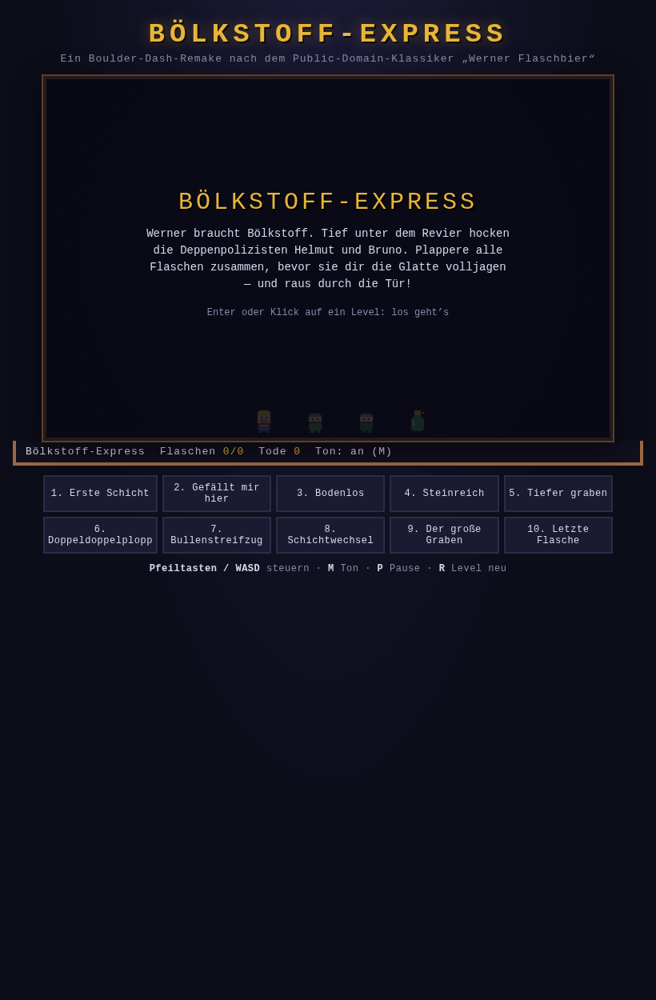

# Bölkstoff-Express



Ein Boulder-Dash-Remake im Browser — in purem JavaScript, ohne Framework, ohne
Build-Schritt, komplett auf Deutsch. Das Spiel ist eine Hommage an den
Public-Domain-Klassiker *Werner Flaschbier* (1989/90) von Realtime Strategies.

Werner braucht Bölkstoff. In den Tiefen des Reviers hocken die Deppenpolizisten
Helmut und Bruno. Sammel alle Bierflaschen ein, bevor dir einer die Glatte
volljagt — und raus durch die Tür, wenn sie auf ist.

## Regeln

- **Steuerung:** Pfeiltasten oder WASD. Werner hält die Richtung, solange die
  Taste gedrückt ist (Boulder-Dash-Style).
- **Erde** kann Werner weggraben; **Steine** brechen, wenn unten etwas steht
  (und werfen ihn sonst auf den Kopf — Plopp!).
- Alle Flaschen pladdert? Die **Tür** öffnet sich — durch sie hindurch ist das
  Level geschafft.
- **Helmut** (blau) und **Bruno** (rot) streifen die Gänge auf und ab.
  Berühren sich Werner und ein Bulle, ist Werner's Schicht zu Ende.
- Werner kann an Wänden und Erdwänden klettern — Bullen nicht.
- `M` Ton an/aus · `P` Pause · `R` Level neu · `Enter` starten/weiter.
- Der Fortschritt (welche Level geschafft sind) wird im Browser gespeichert.

## Starten

Einfach `index.html` im Browser öffnen — oder mit einem kleinen
Webserver:

```sh
python3 -m http.server 8080
# dann http://localhost:8080
```

Optional: Der URL-Parameter `?demo=<0..9>` lässt einen Bot das Level
selbst spielen (nützlich zum Anschauen und Testen).

## Levels

10 Level, alle vom Bot verifiziert lösbar (siehe Tests). Schwierigkeitsgrad:
locker. Die Level liegen in `src/levels.js` als ASCII-Karten:

| Zeichen | Bedeutung |
| --- | --- |
| `#` | Wand |
| `.` | Luft |
| `,` | Erde (grabbar) |
| `-` | Stein (bricht, wenn Boden darunter) |
| `o` | Bierflasche |
| `E` | Tür (Ausgang) |
| `W` | Werner (Start) |
| `H` | Helmut (Bulle) |
| `B` | Bruno (Bulle) |

## Tests

Die Spiellogik ist DOM-frei und wird mit Node getestet — darunter ein
„Bullenspieler“, ein Bot, der alle 10 Level selbst durchspielt und damit
beweist, dass sie lösbar und nicht zu brutal sind:

```sh
node skripte/level-pruefen.js   # prüft alle Level auf Formalfehler
node --test tests/              # Logik + Bot: alle 10 Level gelöst
```

Weitere Skripte in `skripte/`:

- `rendert-vorschau.js` — rendert alle Sprites als PNG/ASCII (ohne Browser)
- `sprites-vorschau.html` — Sprite-Vorschau im Browser

## Architektur

| Datei | Rolle |
| --- | --- |
| `src/logik.js` | Reine Spiellogik (DOM-frei): Bewegung, Schwerkraft, Klettern, Bullen-KI, Flaschen, Tod/Levelende |
| `src/levels.js` | Die 10 Level als ASCII-Karten + Namen |
| `src/sprites.js` | 9 selbstgebaute 16×16-Pixel-Art-Sprites (Zeichenmatrizen + Palette), zur Laufzeit auf Canvas gerendert |
| `src/geraeusche.js` | Alle Soundeffekte per WebAudio-Synthese (Oszillatoren + Rauschen) — keine Audio-Dateien |
| `src/haupt.js` | Die Spielhülle: Game-Loop (Logik per fester Taktung, Rendering per rAF), Tastatur, HUD, Overlays, Level-Auswahl, Fortschritt, Demo-Bot |
| `index.html` | Seite, HUD und Level-Auswahl |

Getrennte Schichten: Logik und Präsentation sind sauber entkoppelt, deshalb
läuft der Bot-Test ohne Browser.

## Spielgefühl

- 16×16-Pixel-Art mit gemeinsamer Palette, 2-fach skaliert, `image-rendering: pixelated`.
- Taktung: Logik tickt fest mit ~6,7 Ticks/Sekunde (unabhängig vom Rendering).
- Kleines Wackeln der Figuren, Rot-Blitz nach dem Tod, goldenes Glühen um die
  offene Tür, Höhlen-Hintergrund mit Vignette.
- Töne: Graben, Stein-Platsch, Flaschen-Plopp, Schritte, Tod, Bulle-gequetscht,
  Tür, Level-gefeiert. Alles synthetisch.

## Lizenz

Code: MIT. Die Idee gehört (wie so vieles in diesem Genre) dem Genre selbst —
Boulder Dash, 1984, First Rate Technologies (Public Domain seit 2000),
*Werner Flaschbier* 1989/90, Realtime Strategies.
